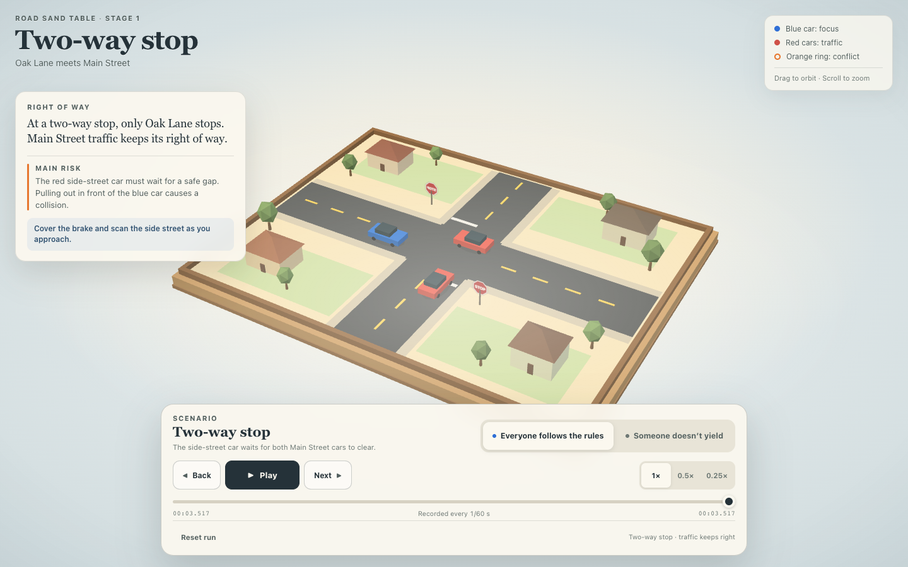
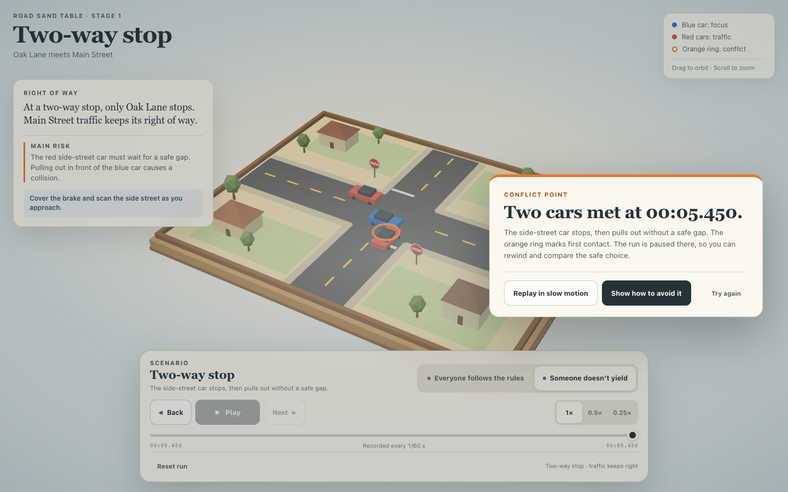
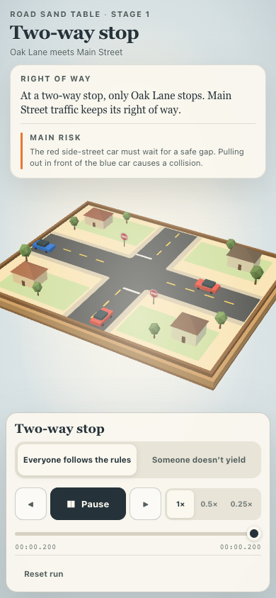

# Road Sand Table

A calm, floating tabletop neighborhood for learning right-of-way rules. It is a
small static Three.js app built for the browser first and Meta Quest WebXR later.

> **Current status: Stage 1 complete and deployed.** Open the live site at
> **<https://evannelson64-cell.github.io/road-sand-table/>** (HTTPS verified).
> This build is desktop/phone only. There is intentionally no WebXR session,
> hand tracking or VR placement yet. Do not expect an **Enter VR** button in
> this stage.







## What works in Stage 1

- A floating wooden sand table with one hand-built neighborhood tile:
  **two-way stop where Main Street traffic does not stop**.
- Right-hand traffic on a road graph with lane paths, stop lines, signs and
  low-poly houses/trees.
- Three cars: a blue focus car on Main Street and two red traffic cars.
- Deterministic car following, safe following distance, stopping at the stop
  line and gap acceptance for the side-street car.
- Play, pause, frame-by-frame stepping, 1x / 0.5x / 0.25x speeds and exact
  scrubbing through recorded history.
- Oriented-box collision detection using the separating-axis theorem. A
  collision pauses the run, places an orange ring at first contact and opens a
  review card.
- **Replay in slow motion**, **Show how to avoid it** (re-runs with the correct
  behavior) and **Try again**.
- Orbit/zoom camera controls on desktop; touch orbit/zoom on phones.
- No runtime CDN, no external APIs, no build step, no secrets.

### The Stage 1 lesson

The blue focus car is eastbound on Main Street. The red car on Oak Lane reaches
a stop sign and must yield to Main Street traffic.

1. Leave **Everyone follows the rules** selected and watch the red car wait for
   both Main Street cars to clear.
2. Choose **Someone doesn’t yield**. The same red car stops and then pulls out
   without a safe gap. The run pauses at first contact.
3. Choose **Replay in slow motion** to see the same recorded moment again, or
   **Show how to avoid it** to watch the safe version at half speed.

The failure is always paired with a successful version, so the lesson ends on
the correct behavior.

## Run it locally

Requirements: Node.js 20 or newer, and a browser with WebGL 2.

```bash
cd road-sand-table
npm ci
npm run serve
# Open http://127.0.0.1:4173
```

There is no build command. `npm run serve` only serves the static files; any
static file server works. Do not open `index.html` with a `file://` URL because
the browser blocks the static JSON fetch and ES modules.

The page is a normal desktop site and also lays out on a phone. Drag to orbit
and scroll/pinch to zoom. `Space` toggles play/pause; the left and right arrow
keys step one recorded frame when focus is not inside a control.

## Test it

```bash
npm test                  # 8 Node unit tests
npx playwright install chromium
npm run test:smoke        # 3 browser smoke tests
npm run test:all          # both
```

The smoke test starts the static server itself and walks through:

- page load with no console errors or failed static requests,
- traffic advancing and the run pausing,
- a no-yield collision, the orange-ring conflict card, and the safe
  **Show how to avoid it** path,
- slow-motion replay plus exact scrub/step-back/step-forward frame checks.

The last local verification was on 2026-11-13: **8/8 unit tests and 3/3
Playwright smoke tests passing** in headless Chromium 141. The deployed site was
also loaded in headless Chrome with no console errors or failed static requests.

## Deploy to GitHub Pages

The live Stage 1 site is:

**<https://evannelson64-cell.github.io/road-sand-table/>**

This repository includes
[`.github/workflows/pages.yml`](.github/workflows/pages.yml), which publishes the
static files on every push to `main`. Pages is enabled with **Source: GitHub
Actions**, and the deployment workflow completed successfully. GitHub Pages
serves the site over HTTPS.

To reproduce this setup for another copy:

1. Create an empty GitHub repository, then add it as `origin`.
2. Push `main` and a feature branch, then open a pull request (do not push
   directly to `main`):

   ```bash
   git remote add origin https://github.com/OWNER/REPO.git
   git push -u origin main
   git push -u origin feat/stage-1-desktop-sand-table
   gh pr create --base main --head --fill
   ```

3. Merge the pull request after review.
4. In the repository, open **Settings → Pages**. Under **Build and deployment**,
   set **Source** to **GitHub Actions**. This is a repository setting and should
   only be enabled after the owner approves it.
5. The workflow deploys automatically. If needed, open **Actions → Deploy static
   site to GitHub Pages → Run workflow**.
6. The URL will be `https://OWNER.github.io/REPO/` over HTTPS.

Equivalent Pages-enable API call, to be run only with approval:

```bash
gh api --method POST repos/OWNER/REPO/pages -f build_type=workflow
```

The site uses only relative URLs, so it works at a project path such as
`/road-sand-table/`, not just at a custom domain.

## Open it on Meta Quest

**Stage 1 does not have WebXR.** You can open the deployed URL in Meta Quest
Browser today and use the 2D touch/orbit version, but there is no immersive
session yet.

Stage 2 will add the immersive flow, at which point the expected process is:

1. Deploy over HTTPS and open the URL in **Meta Quest Browser**.
2. Tap **Enter VR** (to be added in Stage 2).
3. Allow hand tracking if prompted. Controllers must remain available as a
   fallback.
4. Pinch or grip the table to move it, use two hands or the thumbstick to scale,
   and use **Lock placement** / **Reset position** once satisfied.

That headset flow will not be claimed as working until a human tests it on an
actual Quest and reports back.

## Project layout

```text
index.html                     static page and UI markup
styles.css                     desktop, phone and world-panel-ready UI styles
src/main.js                    app loop, fixed-step playback, replay actions
src/sim/simulation.js          traffic rules, car following, stop/yield logic
src/sim/geometry.js            polyline and oriented-box collision math
src/sim/recorder.js            exact per-frame replay storage
src/scene/world.js             Three.js renderer, camera, lights, orbit controls
src/scene/tabletop.js          floating slab, sand, grass and rim
src/scene/roads.js             road ribbons, dashes, stop lines and signs
src/scene/scenery.js           low-poly houses and instanced trees
src/scene/cars.js              low-poly car meshes and contact patches
src/ui.js                      all DOM wiring and accessible controls
data/scenario-two-way-stop.json
vendor/three.module.js         vendored Three.js r169
vendor/addons/controls/OrbitControls.js
tests/unit/                    collision, recorder and deterministic-sim tests
tests/smoke/                   Playwright browser test
.github/workflows/pages.yml    GitHub Pages deployment
```

## Scenario data model

Scenarios are static JSON. There is one file per tile and no runtime map or OSM
request.

- `nodes`: intersections with per-approach controls (`stop`, `yield`, `signal`
  or `none`) and optional yield targets.
- `lanes`: lane centerline polylines, speed and the node/approach they belong
  to. Lane paths are the source of truth for car motion.
- `cars`: car id, lane, start distance and display color.
- `behaviors`: named presets. A preset can give a particular car a violation,
  such as ignoring a yield gap, without changing the geometry.
- `roads`, `signs`, `stopLines`, `scenery`: purely visual data.
- `caption` and `avoidance`: the on-screen rule/risk/habit text and the correct
  behavior used by the safe replay.

The current tile has one lane per direction. Turning paths, signals, pedestrians
and the other nine tiles are Stage 3 work.

## Simulation and replay details

- The simulation runs at a fixed 60 Hz, independent of display refresh rate.
- Each frame records all car state needed to resume exactly, not rendered
  pixels. Scrubbing restores a frame and shows its cars in the same pose.
- History holds 7,200 frames (two simulated minutes) per run. A collision stops
  the run at the first recorded contact.
- The no-yield collision is deterministic at frame 327 in the current scenario.
  Unit tests compare two independent runs and require identical collision data.
- Collision detection is a 2D oriented-box SAT test on the tabletop plane. The
  orange ring is the midpoint of the two car centers, deliberately drawn on top
  so it remains legible.
- There are no shadows, post-processing effects or external assets. Road dashes
  and trees use `InstancedMesh`; the scene is intentionally small and low-poly.

## Assumptions and current limits

- Units are metres in an abstract tabletop scale. The table is 3.8 m × 3.0 m
  with a 3.62 m × 2.82 m play surface.
- Traffic drives on the right. The side street stops; Main Street does not.
- The Stage 1 timeline and car spacing are hand-tuned to make the lesson clear
  and repeatable, not to model real vehicle dynamics.
- Stage 1 does not yet support grabbing/pushing cars, table placement, lock,
  reset position, world-space panels, hand tracking or controllers.
- There is no audio, no gore and no crash animation; the run simply pauses at
  first contact.
- The scene uses a single scenario menu item by design. The ten-tile menu comes
  in Stage 3.
- The collision test is approximate at the car corners and is intended for
  teaching, not safety certification.

## Stage plan

- **Stage 1 — done here:** desktop table, tile 3, traffic, time control, exact
  replay, collision review, tests and deployment workflow.
- **Stage 2 — next:** WebXR `immersive-vr`, floating table placement
  (grab/pinch, twist, two-hand/thumbstick scale, height-only adjust, lock,
  reset), world-space panel, hand tracking with controller fallback. Needs
  emulator checks and then a real Quest test by the human.
- **Stage 3:** the remaining nine scenario tiles plus the scenario menu.
- **Stage 4 (optional):** a one-time Node converter from a small static OSM
  export into this road-graph JSON, with explicit uncertainty flags and no
  runtime OSM calls.

## Credits

Three.js r169 (`vendor/three.module.js`) is vendored under the MIT license; see
[`vendor/THREE-LICENSE.txt`](vendor/THREE-LICENSE.txt). The app code is MIT
licensed; see [`LICENSE`](LICENSE).
