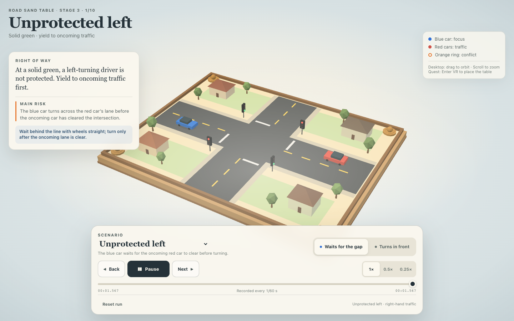
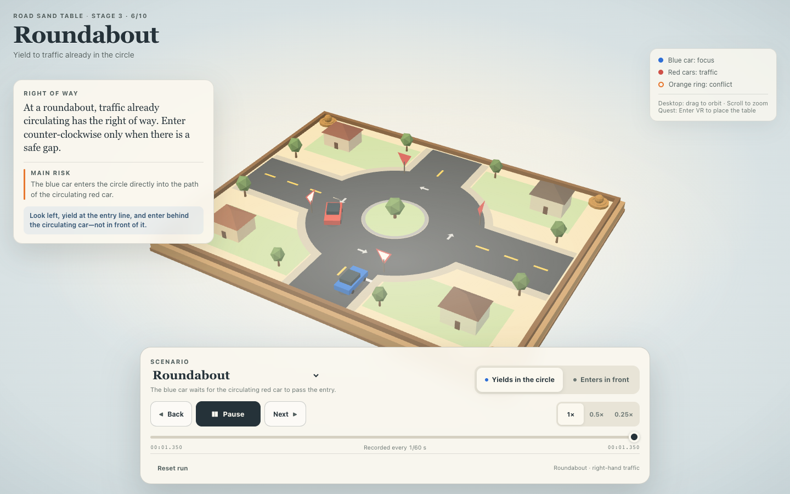
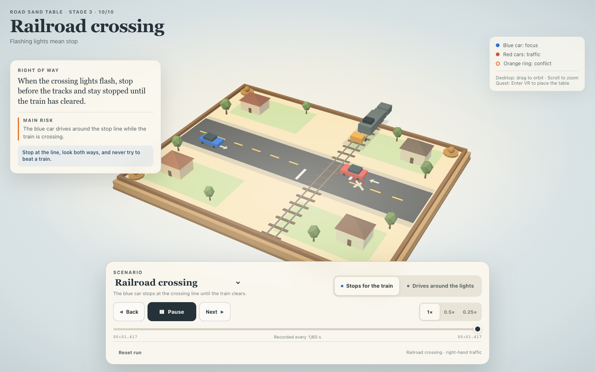
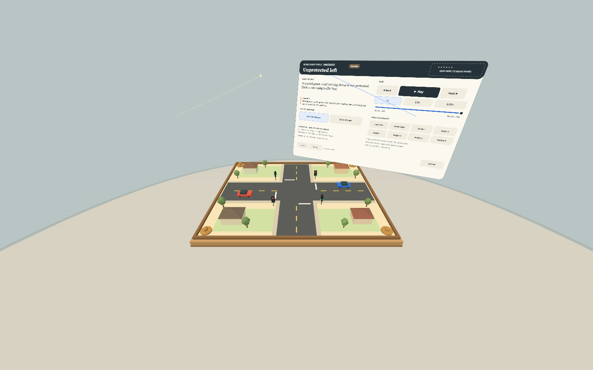
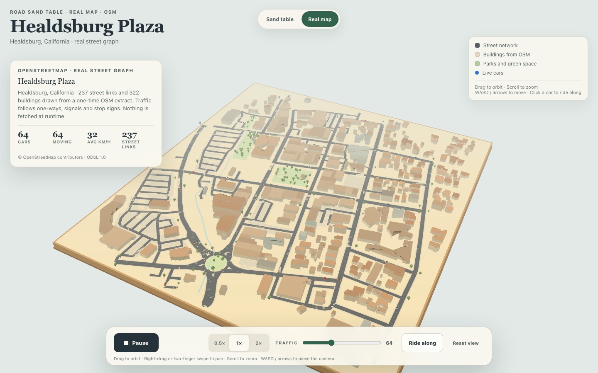
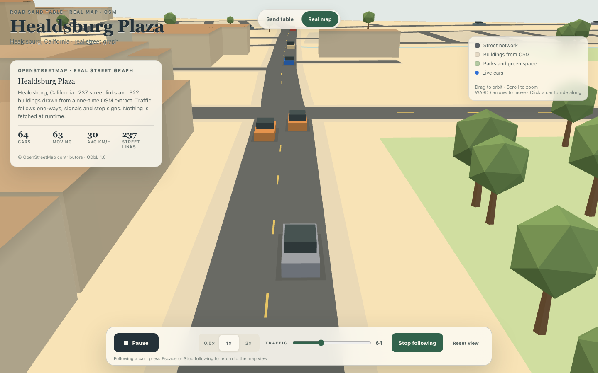
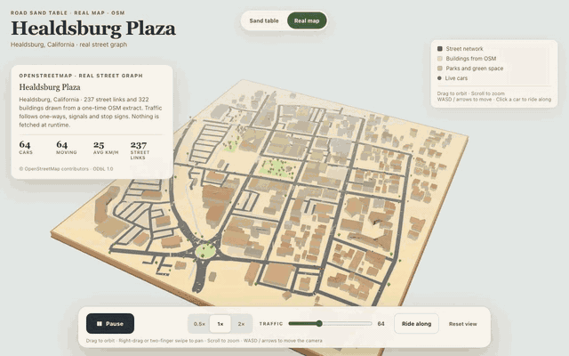
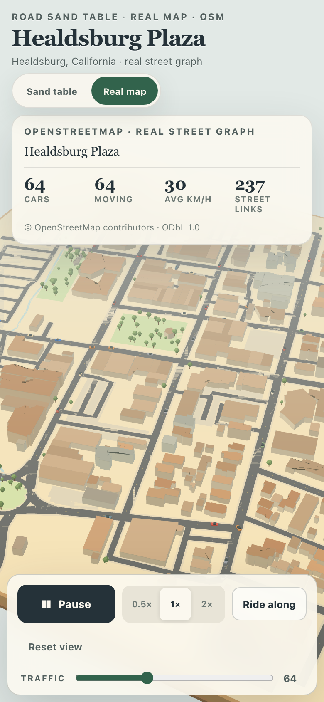

# Road Sand Table

A calm, floating tabletop neighborhood for learning right-of-way rules. It runs
as a normal Three.js page on desktop and phone, and as an immersive **WebXR**
experience on Meta Quest.

There are now **two ways to explore it**: the original ten-scenario sand table,
and a separate **real map** mode built from a one-time OpenStreetMap extract of
Healdsburg Plaza, California. Switching modes never changes or unloads the other
scene.

> **Current status: Stage 3 complete — ten scenario tiles — plus the Stage 4
> real-street map.** The immersive flow passes automated WebXR emulator tests.
> It has **not yet been confirmed on physical Quest hardware**, so treat the live
> VR build as ready to test rather than headset-verified.
>
> **Live site:** <https://evannelson64-cell.github.io/road-sand-table/> (HTTPS)
>
> **Real map direct link:** <https://evannelson64-cell.github.io/road-sand-table/?mode=map>


















## Scenario library

Choose a tile from the **Scenario** menu on desktop, or use **‹ Prev / Next ›**
on the world-space panel in VR. Every tile has a rules-following preset and a
failure preset, plus a three-part caption (rule, main risk, defensive habit).

| # | Scenario | Core lesson |
|---|----------|-------------|
| 1 | **Unprotected left** | At a solid green, yield to oncoming traffic before turning. |
| 2 | **All-way stop** | First arrival goes first; near-simultaneous arrivals yield right. |
| 3 | **Two-way stop** | Side-street traffic yields to the through road. |
| 4 | **T-intersection** | The road that ends yields; a left turn crosses both lanes. |
| 5 | **Highway on-ramp** | Match speed and merge into a safe gap. |
| 6 | **Roundabout** | Yield to circulating traffic; enter counter-clockwise. |
| 7 | **One-way street** | Read the arrows and enter with the flow of traffic. |
| 8 | **Blind spot** | Mirror, signal, shoulder-check before changing lanes. |
| 9 | **Hidden driveway** | Creep around a parked van; do not pull out blind. |
| 10 | **Railroad crossing** | Stop for flashing lights and wait for the train to clear. |

The failure preset always pauses at first contact with an orange conflict ring.
**Replay in slow motion**, **Show how to avoid it**, and **Try again** are
available on desktop and in VR.

## Real map mode

The segmented control at the top of the page switches between **Sand table** and
**Real map**. The real map is a completely separate `THREE.Scene` rendered on the
same WebGL renderer, so the scenario simulation and all ten sand-table layouts
stay exactly as they were.

- **Place:** Healdsburg Plaza, Healdsburg, California.
- **Extract:** 237 street links, 176 junctions, 322 building footprints, parks,
  parking areas, streams, 2 signals, 17 stop signs and 5 yield signs.
- **Traffic:** 64 cars by default, drawn from the static street graph. Cars use
  right-hand offset lanes, follow the car ahead, obey one-way streets, simple
  two-phase signals and approach-mapped stop/yield signs, and take one junction
  box at a time. Density is adjustable from 0 to 180 cars.
- **Camera:** orbit, pan, scroll/pinch zoom, and `WASD` / arrow keys. `Q` / `E`
  rotate; `+` / `−` zoom. Click any car, or press **Ride along**, to follow it.
  `Escape` returns to the overview.
- **Controls:** pause/play, 0.5× / 1× / 2× traffic speed, density, ride along and
  reset view. The info card reports live cars, moving cars, average speed and
  street-link count.
- **Deep link:** add `?mode=map` to open the real map directly.
- **No runtime service calls:** the browser only reads the committed
  `data/maps/healdsburg-plaza.json` file. It never contacts Overpass or any other
  map API.

The low-poly treatment deliberately matches the sand table: flat-shaded
buildings with muted roofs, a wooden plinth, paper-and-sand colours, no textures,
no shadows, and the same calm typography.

### Map data pipeline

The extract is committed once and converted ahead of time:

```text
data/osm/healdsburg-plaza.query.overpassql   documented Overpass query
data/osm/healdsburg-plaza.raw.json           raw one-time Overpass response
scripts/lib/osm-graph.mjs                    projection, graph splitting, tags
scripts/osm-to-graph.mjs                     converter CLI
data/maps/healdsburg-plaza.json              static document loaded by the app
```

Regenerate the app document after replacing the raw extract:

```bash
node scripts/osm-to-graph.mjs \
  data/osm/healdsburg-plaza.raw.json \
  data/maps/healdsburg-plaza.json \
  --id=healdsburg-plaza \
  --name="Healdsburg Plaza" \
  --place="Healdsburg, California" \
  --bounds=38.6078,-122.8730,38.6134,-122.8665 \
  --source="Overpass API extract, 2026-11-17"
```

The converter keeps a `drivable` flag on every edge. Parking aisles, driveways,
private ways and emergency access stay visible but do not carry demo traffic.

## What works

- Ten static, hand-built scenario tiles sharing one calm tabletop environment.
- A separate real-map mode built from a committed OpenStreetMap extract, with
  vehicles on the actual street graph, approach-mapped signs and signals,
  orbit/pan/zoom navigation and a click-to-follow ride-along camera.
- A top-centre mode switch that preserves both scenes; `?mode=map` links
  straight to the map without changing any scenario defaults.
- Smooth Catmull-Rom turn and merge paths, sampled into exact arc-length
  trajectories so turning cars rotate continuously instead of snapping.
- Traffic-light phases, unprotected-left yielding, all-way arrival ordering
  with a right-of-way tie-break, roundabout conflict checking, merge yielding,
  blind-spot lane-change gaps, parked-vehicle occlusion and a moving train.
- Deterministic simulation at a fixed 60 Hz.
- Play, pause, frame stepping, 1x / 0.5x / 0.25x speeds and exact scrubbing.
- Oriented-box collision detection for car-car and car-train contact.
- Desktop orbit/zoom; phone touch layout.
- Immersive WebXR with a room-scale table, four corner grips, two-hand scaling,
  thumbstick movement, a grabbable world-space control panel, and optional hand
  tracking with controller fallback.
- No runtime CDN, no external APIs, no build step, no secrets.

## Run it locally

Requirements: Node.js 20 or newer and a browser with WebGL 2.

```bash
cd road-sand-table
npm ci
npm run serve
# Open http://127.0.0.1:4173
```

There is no build command. `npm run serve` is just a static file server. Do not
open `index.html` through `file://`, because the browser blocks the JSON fetch
and ES modules.

The page works on desktop and phone. Drag to orbit and scroll/pinch to zoom.
`Space` toggles play/pause; left/right arrow keys step one frame when focus is
not inside a control. The **Enter VR** button appears only when the browser
reports `immersive-vr` support.

To open the real map directly, use
**<http://127.0.0.1:4173/?mode=map>**, or use the **Sand table / Real map** switch
at the top of the page.

## Immersive table controls

The physical table is about **1.06 m × 0.84 m**, with its top at **0.85 m**.
It starts about 1.0 m in front of the viewer, putting the near edge roughly
0.6 m away.

- **Move in any direction:** grip/pinch any of the four brass corner grips.
- **Rotate:** twist your wrist while holding a corner.
- **Scale:** grip/pinch two corners and move your hands apart or together.
- **Thumbsticks:** left moves the table horizontally; right adjusts
  height/rotation.
- **Height-only:** panel **Height − / Height +** buttons.
- **Lock:** stops corner and thumbstick movement.
- **Reset table:** puts the table in front of your current view and unlocks it.
- **Scenario navigation:** **‹ Prev / Next ›** at the bottom of the VR panel.
- **Move the panel:** grip its dashed header.
- **Exit VR:** panel button or Quest system menu.

Controllers use the trigger for panel buttons and squeeze to grab. Hand tracking
is requested as an optional session feature; a pinch performs the same action
when hands are active. Controllers remain the fallback.

## Test it

```bash
npm test                  # 29 Node unit tests
npx playwright install chromium
npm run test:smoke        # 12 browser tests: 4 sand-table + 5 real-map + 3 WebXR
npm run test:all          # both
```

The unit suite loads **all ten scenario JSON files** and requires each correct
preset to be collision-free for 30 simulated seconds **and** each failure preset
to produce a collision. It also covers collision math, exact replay, placement
clamping and the scenario catalog. The map tests re-run the OSM converter,
check the committed map document is reproducible from the raw extract, validate
lane and approach-control invariants, and run the traffic model for 40 simulated
seconds to check for NaNs, stuck fleets and deterministic seeds.

The desktop smoke tests cover the original sand table and the real map: mode
switching, static map loading, live traffic, pause, speed, density, ride along,
`Escape`, and a clean return to `?mode=`-less sand-table state.

The WebXR tests use Meta's **Immersive Web Emulation Runtime (IWER)** through
[`playwright-webxr`](https://www.npmjs.com/package/playwright-webxr), with the
`metaQuest2` device profile. They verify session entry/teardown, panel buttons,
timeline seeking, thumbsticks, lock/reset, panel dragging, corner grabbing,
two-hand scaling, scenario navigation, collision review and the safe replay.

Last local verification: **29/29 unit tests and 12/12 Playwright tests passing**
in headless Chromium 141. The live site is served over HTTPS by GitHub Pages.

**What the emulator cannot verify:** tracked-hand joint poses, pinch gestures
and physical 72 fps. IWER enables the optional `hand-tracking` feature but
provides controllers instead of real hand joints. Those checks need the actual
Quest 2.

## Open it on Meta Quest 2

1. Open **<https://evannelson64-cell.github.io/road-sand-table/>** in **Meta
   Quest Browser**.
2. Press **Enter VR**. Allow hand tracking if offered; controllers remain the
   fallback.
3. Look down at the table. The world-space panel is to the right at about 1.2 m.
4. Grip a brass corner and move/twist the table. Grip the dashed panel header
   to reposition the panel. Press panel buttons with the trigger.
5. Try left/right thumbsticks, **Lock**, **Reset table**, and two corner grips
   for scaling.
6. Use **‹ Prev / Next ›** to step through all ten scenarios.
7. Run each failure preset and confirm that the conflict pauses and **Show safe
   version** plays the correct behavior.
8. Report whether placement, rotation, scaling, panel readability and the new
   scenario visuals feel comfortable on the headset.

The headset flow is not claimed as working until that test is complete.

## Deploy to GitHub Pages

The live site is:

**<https://evannelson64-cell.github.io/road-sand-table/>**

This repository includes
[`.github/workflows/pages.yml`](.github/workflows/pages.yml), which publishes
the static files on every push to `main`. Pages is enabled with **Source:
GitHub Actions**, and GitHub Pages serves the site over HTTPS.

To reproduce this setup for another copy:

1. Create an empty GitHub repository, then add it as `origin`.
2. Push `main` and a feature branch, then open a pull request (do not push
   directly to `main`):

   ```bash
   git remote add origin https://github.com/OWNER/REPO.git
   git push -u origin main
   git push -u origin feat/stage-3-scenario-library
   gh pr create --base main --head --fill
   ```

3. Merge the pull request after review.
4. In the repository, open **Settings → Pages**. Under **Build and deployment**,
   set **Source** to **GitHub Actions**. This is a repository setting and should
   only be enabled after the owner approves it.
5. The workflow deploys automatically. If needed, open **Actions → Deploy static
   site to GitHub Pages → Run workflow**.
6. The URL will be `https://OWNER.github.io/REPO/` over HTTPS.

The site uses only relative URLs, so it works at a project path such as
`/road-sand-table/`.

## Project layout

```text
index.html                       static page and HTML controls
styles.css                       desktop, phone and XR UI styles
src/main.js                      app loop, scenario catalog, replay and XR glue
src/sim/                         deterministic simulation, collision and replay
src/sim/geometry.js              paths, Catmull-Rom smoothing and OBB collision
src/sim/simulation.js            signals, all-way stops, roundabouts, trains
src/scene/world.js               renderer, lights, reloadable table root
src/scene/tabletop.js            floating slab, sand, grass and rim
src/scene/cornerHandles.js        four brass grab handles
src/scene/roads.js               roads, lane paint, signs and stop lines
src/scene/props.js               traffic lights, arrows, islands, van, crossing
src/scene/trains.js              low-poly freight train
src/scene/scenery.js             houses and instanced trees
src/scene/cars.js                low-poly car meshes and contact patches
src/map/graph.js                 lane network, connectors, signals, approach signs
src/map/traffic.js               deterministic real-street traffic and junction locks
src/scene/mapScene.js            low-poly OSM scene, orbit camera and ride along
src/xr/session.js                immersive-vr session lifecycle
src/xr/tablePlacement.js         room-scale transform and constraints
src/xr/input.js                  controllers, hand pinches and table grabs
src/xr/controlPanel.js           canvas-rendered world-space panel
src/ui.js                        desktop/phone DOM controls and mode switch
data/scenarios.json              scenario catalog and menu order
data/scenario-*.json             ten hand-authored tiles
data/osm/                        documented Overpass query and raw one-time extract
data/maps/                       converted static map documents
scripts/lib/osm-graph.mjs        OSM projection, graph splitting and tag handling
scripts/osm-to-graph.mjs         one-time Overpass JSON converter CLI
scripts/preview-map.mjs          README screenshot helper
vendor/three.module.js           vendored Three.js r169
vendor/addons/controls/OrbitControls.js
tests/unit/                      simulation, collision, replay, catalog, OSM graph
tests/smoke/                     desktop, real-map and WebXR emulator tests
.github/workflows/pages.yml      GitHub Pages deployment
```

## Scenario data model

Scenarios are static JSON and no runtime map service is contacted.

- `nodes`: intersections, per-approach controls (`stop`, `yield`, `signal`,
  `rail` or `none`), signal phases, all-way ordering, roundabout geometry and
  rail-crossing activation.
- `lanes`: lane centerlines. Add `smooth: true` to sample a Catmull-Rom curve
  through the control points. Optional `stopAt` gives an exact stopping distance
  for curved entry ramps or roundabouts.
- `cars`: car id, lane, start distance and display color.
- `trains`: moving train actors with a lane, length and speed.
- `behaviors`: named presets. A preset can make a car ignore a yield, all-way
  turn, or rail signal without changing the geometry.
- `trafficLights`, `roundabouts`, `parkedVehicles`, `laneArrows`,
  `railCrossings`, `roads`, `signs`, `stopLines`, `scenery`: visual data.
- `caption` and `avoidance`: the rule/risk/habit text and safe replay.

### Real-map document

Real-map mode reads one compact document, `data/maps/healdsburg-plaza.json`,
generated from the raw Overpass response. It contains no live service URLs.

- `origin`, `bbox`, `size`: the projection origin and real-world dimensions in
  metres. North is `−Z`.
- `nodes` and `edges`: the routable street graph. Each edge has a polyline,
  width, class, speed, lane count, one-way flag and `drivable` flag.
- `buildings`: simplified footprints with a `kind` and height in metres.
- `areas` and `streams`: parks, water, parking and stream centrelines.
- `signals`, `stops`, `yields`: projected control positions. The runtime maps
  stop and yield signs to the approach lane that actually faces them.
- `stats` and `attribution`: counts shown in the UI and the required ODbL
  credit.

`src/map/graph.js` expands each edge into directed lanes, offsets them to the
right, builds cubic junction connectors, and exposes signal timing. Parking
aisles and driveways remain visible but are excluded from traffic when
`drivable` is false.

## Important assumptions

- This is a teaching model using **generic North American right-hand traffic**,
  not legal advice. Right-on-red, school-bus, railroad and local intersection
  rules vary by jurisdiction. The current tiles avoid jurisdiction-specific
  edge cases where possible.
- Real-map data is a **one-time OpenStreetMap snapshot dated 2026-11-17**, not a
  live navigation service. Streets, signs and buildings may be incomplete or
  have changed since the extract.
- Real-map traffic is a visual model. It is not a routing engine, a traffic
  study or a safety certification. Signals use a simplified 24-second two-phase
  cycle, pedestrians and cyclists are omitted, and one car reserves a junction
  box at a time.
- Parking aisles, driveways, private ways and emergency access are rendered for
  context but deliberately do not carry demo traffic.
- Signal timing is simplified: one green/yellow/all-red cycle with no pedestrian
  phase. Unprotected-left logic yields to oncoming traffic.
- All-way stops use first-arrival order, with a right-hand tie-break for arrivals
  within 150 ms.
- The roundabout uses one circulating lane and a geometric conflict zone at the
  entry.
- The railroad scenario has one freight train and flashing red lights; there is
  no gate arm or train horn.
- The scene uses a calm virtual floor in VR rather than passthrough or room
  meshes.
- Collision detection is an approximate 2D oriented-box test, not a safety
  certification.
- There is no audio, no gore and no crash animation; a conflict pauses at first
  contact.
- Per-frame replay history holds 7,200 frames (two simulated minutes).

## Stage plan

- **Stage 1 — complete:** desktop table, two-way stop, traffic, exact replay,
  collision review.
- **Stage 2 — implemented, emulator verified:** immersive WebXR, room-scale
  four-corner placement, two-hand scaling, world-space panel, controller/hand
  input. Physical Quest confirmation still pending.
- **Stage 3 — complete:** all ten scenario tiles, smooth turn/merge geometry,
  signals, all-way ordering, roundabout, train, scenario menus and full tests.
- **Stage 4 — complete:** separate real-map mode with a committed OSM extract,
  a Node converter, live traffic on the real street graph, orbit/pan/zoom
  navigation, ride-along camera, mode switching and map tests.
- **Stage 5 (optional):** additional extracts or a larger regional graph, plus
  richer junction behaviour such as pedestrian phases, turn lanes and
  roundabout-specific entry rules.

## Credits

Three.js r169 (`vendor/three.module.js`) is vendored under the MIT license; see
[`vendor/THREE-LICENSE.txt`](vendor/THREE-LICENSE.txt). The app code is MIT
licensed; see [`LICENSE`](LICENSE).

Real-map data in `data/osm/` and `data/maps/` is
**© OpenStreetMap contributors**, available under the
[Open Database License (ODbL) 1.0](https://www.openstreetmap.org/copyright).
The extract is stored statically and the app does not contact OpenStreetMap
servers at runtime. Any redistributed derivative of that data must keep the same
attribution and ODbL terms.
