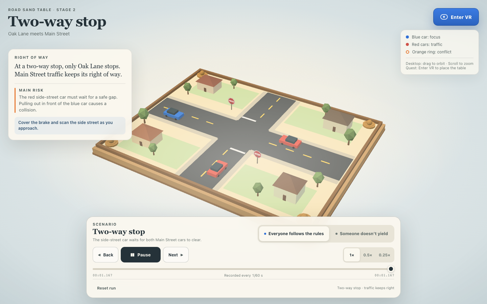
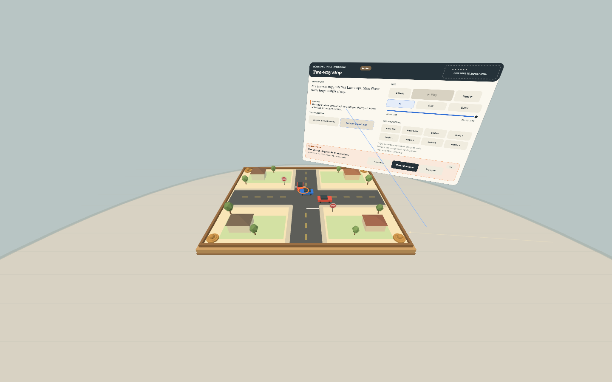

# Road Sand Table

A calm, floating tabletop neighborhood for learning right-of-way rules. It runs
as a normal Three.js page on desktop and phone, and as an immersive **WebXR**
experience on Meta Quest.

> **Current status: Stage 2 implementation complete.** The immersive flow passes
> automated WebXR emulator tests. It has **not yet been confirmed on physical
> Quest hardware** — that is the next required check.
>
> **Live site:** <https://evannelson64-cell.github.io/road-sand-table/> (HTTPS)






## What works

- A floating wooden sand table with one hand-built neighborhood tile:
  **two-way stop where Main Street traffic does not stop**.
- Right-hand traffic on a road graph with lane paths, stop lines, signs and
  low-poly houses/trees.
- Three cars: a blue focus car on Main Street and two red traffic cars.
- Deterministic car following, safe following distance, stopping at the stop
  line and gap acceptance for the side-street car.
- Play, pause, frame-by-frame stepping, 1x / 0.5x / 0.25x speeds and exact
  scrubbing through recorded history.
- Oriented-box collision detection using the separating-axis theorem. A
  collision pauses the run, places an orange ring at first contact and opens a
  review card.
- **Replay in slow motion**, **Show how to avoid it** (re-runs with the correct
  behavior) and **Try again**.
- Desktop orbit/zoom and touch orbit/zoom on phones.
- **Immersive VR** with a room-scale table, four corner grab handles, a
  grabbable world-space control panel and controller/hand input.
- No runtime CDN, no external APIs, no build step, no secrets.

### The lesson

The blue focus car is eastbound on Main Street. The red car on Oak Lane reaches
a stop sign and must yield to Main Street traffic.

1. Leave **Everyone follows the rules** selected and watch the red car wait for
   both Main Street cars to clear.
2. Choose **Someone doesn’t yield**. The same red car stops and then pulls out
   without a safe gap. The run pauses at first contact.
3. Choose **Replay in slow motion** to see the same recorded moment again, or
   **Show how to avoid it** to watch the safe version at half speed.

The failure is always paired with a successful version, so the lesson ends on
the correct behavior. In VR the same actions are buttons on the world-space
control panel.

## Run it locally

Requirements: Node.js 20 or newer and a browser with WebGL 2.

```bash
cd road-sand-table
npm ci
npm run serve
# Open http://127.0.0.1:4173
```

There is no build command. `npm run serve` only serves the static files; any
static file server works. Do not open `index.html` with a `file://` URL because
the browser blocks the static JSON fetch and ES modules.

The page is a normal desktop site and also lays out on a phone. Drag to orbit
and scroll/pinch to zoom. `Space` toggles play/pause; the left and right arrow
keys step one recorded frame when focus is not inside a control.

The **Enter VR** button appears only when the browser reports support for
`immersive-vr`; opening the same page on a headset or in an emulator enables it.

## Immersive table controls

The physical table is about **1.06 m × 0.84 m**, with its top at **0.85 m**.
It starts about 1.0 m in front of the viewer, putting the near edge roughly
0.6 m away.

- **Move in any direction:** grip/pinch any of the four brass corner grips and
  move your hand. Translation includes up/down, left/right and forward/back.
- **Rotate:** twist your wrist while holding a corner.
- **Scale:** grip/pinch two corners and move your hands apart or together.
- **Thumbsticks:** left stick moves the table horizontally relative to you;
  right stick up/down changes height and left/right rotates.
- **Height-only:** the panel’s **Height − / Height +** buttons.
- **Lock:** stops corner/thumbstick movement until pressed again.
- **Reset table:** places the table in front of your current view at the default
  size and unlocks it.
- **Move the controls:** grip the dashed header on the panel and move it.
- **Exit VR:** panel button, or the Quest system menu.

Controllers use the trigger to press panel buttons and squeeze to grab the table
or panel. Hand tracking is requested as an optional session feature; when hands
are active, pinch performs the same action. Controllers remain the fallback.

## Test it

```bash
npm test                  # 10 Node unit tests
npx playwright install chromium
npm run test:smoke        # 5 browser tests: 3 desktop + 2 WebXR
npm run test:all          # both
```

The WebXR tests use Meta's **Immersive Web Emulation Runtime (IWER)** through
[`playwright-webxr`](https://www.npmjs.com/package/playwright-webxr), with the
`metaQuest2` device profile. They verify:

- immersive session entry and clean teardown back to the desktop UI,
- table scale, initial placement and all four corner grips,
- panel buttons, height/rotate/scale changes, panel dragging and timeline seeking,
- left/right thumbsticks, lock blocking both movement and corner grabs, and reset,
- single-corner grab translation and two-hand scaling,
- the collision pause, orange ring and **Show safe version** flow inside VR,
- no console errors or page errors.

The last local verification was on 2026-11-13: **10/10 unit tests and 5/5
Playwright smoke tests passing** in headless Chromium 141. The emulator reported
164 render calls across both eyes for the VR scene. A physical 72 fps measurement
has **not** been made.

**What the emulator cannot verify:** tracked-hand joint poses and pinch gestures.
IWER enables the optional `hand-tracking` session feature, but the test harness
provides controllers rather than real hand joints. Hand behavior therefore still
needs a physical Quest 2 test.

## Deploy to GitHub Pages

The live site is:

**<https://evannelson64-cell.github.io/road-sand-table/>**

This repository includes
[`.github/workflows/pages.yml`](.github/workflows/pages.yml), which publishes the
static files on every push to `main`. Pages is already enabled with **Source:
GitHub Actions**, and GitHub Pages serves the site over HTTPS.

To reproduce this setup for another copy:

1. Create an empty GitHub repository, then add it as `origin`.
2. Push `main` and a feature branch, then open a pull request (do not push
   directly to `main`):

   ```bash
   git remote add origin https://github.com/OWNER/REPO.git
   git push -u origin main
   git push -u origin feat/stage-2-webxr-placement
   gh pr create --base main --head --fill
   ```

3. Merge the pull request after review.
4. In the repository, open **Settings → Pages**. Under **Build and deployment**,
   set **Source** to **GitHub Actions**. This is a repository setting and should
   only be enabled after the owner approves it.
5. The workflow deploys automatically. If needed, open **Actions → Deploy static
   site to GitHub Pages → Run workflow**.
6. The URL will be `https://OWNER.github.io/REPO/` over HTTPS.

Equivalent Pages-enable API call:

```bash
gh api --method POST repos/OWNER/REPO/pages -f build_type=workflow
```

The site uses only relative URLs, so it works at a project path such as
`/road-sand-table/`.

## Open it on Meta Quest 2

This is the test that still needs a human:

1. Open **<https://evannelson64-cell.github.io/road-sand-table/>** in **Meta Quest
   Browser** on the headset. The URL is HTTPS and the repo is public.
2. Press **Enter VR**. Allow hand tracking if offered; controllers remain the
   fallback.
3. Look down at the table. The world-space panel is to the right at about
   1.2 m. Grip a brass corner and move/twist the table.
4. Grip the panel’s dashed header to reposition the panel. Press buttons with
   the controller trigger.
5. Try left/right thumbsticks, **Lock**, **Reset table**, and two corner grips
   for scaling.
6. Run the **Someone doesn’t yield** preset and confirm that the conflict pauses
   and **Show safe version** plays the correct behavior.
7. Report back whether placement, rotation, scaling and panel readability work
   comfortably. Do not treat this README as proof until that hardware test is
   complete.

## Project layout

```text
index.html                     static page and UI markup
styles.css                     desktop, phone and XR UI styles
src/main.js                    app loop, fixed-step playback, XR integration
src/sim/                        deterministic simulation, collision and replay
src/scene/world.js              renderer, lights, table root and orbits
src/scene/tabletop.js           floating slab, sand, grass and rim
src/scene/cornerHandles.js      four brass grab handles
src/scene/roads.js              road ribbons, dashes, stop lines and signs
src/scene/scenery.js            low-poly houses and instanced trees
src/scene/cars.js               low-poly car meshes and contact patches
src/xr/session.js               immersive-vr session lifecycle
src/xr/tablePlacement.js        room-scale table transform and constraints
src/xr/input.js                 controller rays, hand pinches and table grabs
src/xr/controlPanel.js          canvas-rendered world-space panel
src/ui.js                       desktop/phone DOM controls
data/scenario-two-way-stop.json
vendor/three.module.js          vendored Three.js r169
vendor/addons/controls/OrbitControls.js
tests/unit/                     collision, replay and placement tests
tests/smoke/                    desktop and WebXR emulator tests
.github/workflows/pages.yml     GitHub Pages deployment
```

## Scenario data model

Scenarios are static JSON. There is one file per tile and no runtime map or OSM
request.

- `nodes`: intersections with per-approach controls (`stop`, `yield`, `signal`
  or `none`) and optional yield targets.
- `lanes`: lane centerline polylines, speed and the node/approach they belong
  to. Lane paths are the source of truth for car motion.
- `cars`: car id, lane, start distance and display color.
- `behaviors`: named presets. A preset can give a particular car a violation,
  such as ignoring a yield gap, without changing the geometry.
- `roads`, `signs`, `stopLines`, `scenery`: purely visual data.
- `caption` and `avoidance`: the rule/risk/habit text and the correct behavior
  used by the safe replay.

The current tile has one lane per direction. Turning paths, signals, pedestrians
and the other nine tiles are Stage 3 work.

## Simulation and replay details

- The simulation runs at a fixed 60 Hz, independent of display refresh rate.
- Each frame records all car state needed to resume exactly, not rendered
  pixels. Scrubbing restores a frame and shows its cars in the same pose.
- History holds 7,200 frames (two simulated minutes) per run. A collision stops
  the run at the first recorded contact.
- The no-yield collision is deterministic at frame 327 in the current scenario.
  Unit tests compare two independent runs and require identical collision data.
- Collision detection is a 2D oriented-box SAT test on the tabletop plane. The
  orange ring is the midpoint of the two car centers, deliberately drawn on top
  so it remains legible.
- There are no shadows, post-processing effects or external assets. Road dashes
  and trees use `InstancedMesh`; the scene is intentionally small and low-poly.

## Assumptions and current limits

- Units are metres. For desktop, the original 3.8 m × 3.0 m world table is used
  by the orbit camera. For VR, the same table is scaled to 28% — about
  1.06 m × 0.84 m — so it reads as a physical tabletop.
- Traffic drives on the right. The side street stops; Main Street does not.
- The timeline and car spacing are hand-tuned to make the lesson clear and
  repeatable, not to model real vehicle dynamics.
- The VR scene uses a calm virtual floor and colour background. It does **not**
  use Quest scene meshes or passthrough.
- Hand tracking is implemented as an optional input path but has not yet been
  exercised with real hand joints. Controllers are the verified path.
- Pushing individual cars with the hand/controller is still deferred.
- There is no audio, no gore and no crash animation; the run simply pauses at
  first contact.
- The scene uses one scenario tile by design. The ten-tile menu comes in Stage 3.
- The collision test is approximate at the car corners and is intended for
  teaching, not safety certification.

## Stage plan

- **Stage 1 — complete:** desktop table, tile 3, traffic, time control, exact
  replay, collision review, tests and deployment workflow.
- **Stage 2 — implemented, emulator verified:** immersive WebXR, four-corner
  room-scale placement, rotation, two-hand scaling, height adjustment, lock,
  reset, world-space panel, hand tracking with controller fallback. Awaiting
  physical Meta Quest 2 confirmation.
- **Stage 3:** the remaining nine scenario tiles plus the scenario menu.
- **Stage 4 (optional):** a one-time Node converter from a small static OSM
  export into this road-graph JSON, with explicit uncertainty flags and no
  runtime OSM calls.

## Credits

Three.js r169 (`vendor/three.module.js`) is vendored under the MIT license; see
[`vendor/THREE-LICENSE.txt`](vendor/THREE-LICENSE.txt). The app code is MIT
licensed; see [`LICENSE`](LICENSE).
